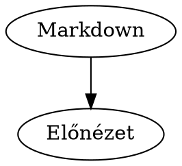
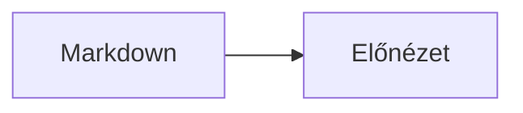

# Markdown Preview

Egyszerű, valós idejű Markdown előnézet két panellel, fejlett Markdown-kiegészítések támogatásával. Nincs szükség buildre vagy telepítésre; a projekt GitHub Pages-en statikus weboldalként publikálható.

Aktuális verzió: **1.1.1**. A verzió az oldal fejlécében is látható; a kiadások változásait a [CHANGELOG.md](./CHANGELOG.md) követi.

## Futtatás

Nyisd meg az `index.html` fájlt böngészőben. A Marked és a DOMPurify induláskor töltődik be; a Mermaid, KaTeX, a lábjegyzet-kiegészítő, a szintaxiskiemelő, a Chart.js és a Graphviz csak akkor, ha a beírt Markdown használja. Az alkalmazás első betöltéséhez és a kiegészítők letöltéséhez internetkapcsolat szükséges.

A CDN-címek verziói rögzítettek, a JavaScript- és CSS-fájlokat pedig Subresource Integrity (SRI) ellenőrzés védi. Ha egy rögzített fájl tartalma megváltozik, a böngésző nem tölti be; ilyenkor az elvárt verzióhoz tartozó SRI-hash-t kell frissíteni.

A Markdown tartalom feldolgozása és a diagramok renderelése a böngészőben történik. A Markdownba írt külső képek és hivatkozások megnyitásakor a böngésző kapcsolatot kezdeményezhet a megadott külső címek felé.

## Támogatott elemek

- GitHub Flavored Markdown: táblázatok, áthúzás, automatikus linkek és feladatlisták
- Mermaid diagramok a `mermaid` kódblokkokban
- Graphviz DOT diagramok a `dot` vagy `graphviz` kódblokkokban
- Matematikai képletek KaTeX-szel: `$...$` soron belül, `$$...$$` külön sorban
- Lábjegyzetek a `[^jelölés]` és `[^jelölés]: magyarázat` formával
- Definíciós listák a kifejezés utáni `: meghatározás` sorral
- Szintaxiskiemelés a nyelvvel megjelölt kódblokkokban
- Vonal-, oszlop-, kör-, doughnut-, radar- és polar area grafikonok `chart` JSON blokkokban

Példák:

````markdown
Szorozzuk össze: $a^2 + b^2 = c^2$.

Itt egy lábjegyzet[^megjegyzes].

[^megjegyzes]: A lábjegyzet szövege.

Markdown
: Könnyű szövegleíró formátum.

```chart
{
  "type": "bar",
  "labels": ["Jan", "Feb", "Már"],
  "datasets": [
    { "label": "Eladások", "data": [12, 19, 8] }
  ]
}
```


````

Mermaid diagramot a `mermaid` nyelvű kódblokkal adhatsz hozzá:

````markdown

````

## GitHub Pages

1. Töltsd fel a fájlokat egy GitHub-repozitóriumba.
2. A repozitórium **Settings → Pages** oldalán válaszd ki a publikálási forrást.
3. Állítsd be a `main` ágat és a gyökérkönyvtárat (`/`), majd mentsd el.

Az `index.html` és a hozzá tartozó fájlok a gyökérkönyvtárban vannak, így további build- vagy deploy-konfiguráció nem szükséges.

## Verziózás

A projekt SemVer formátumú verziót használ (`MAJOR.MINOR.PATCH`). A megjelenített verziót az `index.html` `app-version` meta mezőjében kell frissíteni, a változásokat pedig a `CHANGELOG.md` fájlban kell rögzíteni. A GitHub Pages az új verziót akkor jeleníti meg, amikor a módosítások felkerülnek a `main` ágra.
