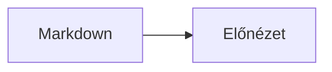
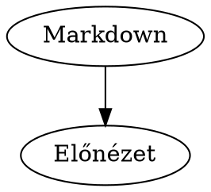

# Markdown Preview

Írj vagy illessz be Markdown-szöveget a bal oldali szerkesztőbe, és a jobb oldalon azonnal látod a formázott előnézetet.

[Élő oldal megnyitása a GitHub Pagesen](https://k-szabo.github.io/markdown-preview/)

## Megjelenés

Első használatkor az alkalmazás a számítógéped színsémáját követi. A fejlécben található **Sötét mód / Világos mód** gombbal válthatsz témát. A választásod a böngészőben elmentődik.

## Munkaterület

A **Nézet** gombokkal megjelenítheted mindkét panelt, vagy csak a szerkesztőt, illetve csak az előnézetet. Kétpaneles nézetben húzd az elválasztót a panelek átméretezéséhez; billentyűzettel az elválasztóra fókuszálva bármelyik nyílbillentyűvel módosíthatod az arányt: balra/felfelé csökkentheted, jobbra/lefelé növelheted a szerkesztő méretét.

Az előnézetben a Mermaid- és Graphviz-diagramokat az egérgörgővel nagyíthatod vagy kicsinyítheted, majd bal egérgombbal húzva mozgathatod.

Az előnézetben a Mermaid- és Graphviz-diagramokat, valamint a grafikonokat a jobb felső sarkukban lévő gombbal teljes képernyőre válthatod; ugyanazzal a gombbal vagy az `Esc` billentyűvel léphetsz ki.

## Támogatott Markdown-elemek

- Címsorok, bekezdések, felsorolások és számozott listák
- Félkövér, dőlt, áthúzott szöveg, idézetek, linkek és képek
- Táblázatok és feladatlisták
- Matematikai képletek: `$x^2$` soron belül, vagy `$$x^2$$` külön sorban
- Lábjegyzetek és definíciós listák
- Kiemelt kódblokkok, például `js`, `python` vagy `json` jelöléssel
- Mermaid diagramok `mermaid` kódblokkokban
- Graphviz diagramok `dot` vagy `graphviz` kódblokkokban
- Vonal-, oszlop-, kör-, doughnut-, radar- és polar area grafikonok `chart` JSON kódblokkokban

## Mermaid-diagram

Írd a diagramot egy `mermaid` nyelvű kódblokkba:

````markdown

````

## Matematikai képlet és lábjegyzet

````markdown
Euler azonossága: $e^{i\pi} + 1 = 0$.

Ez egy lábjegyzetre hivatkozik[^megjegyzes].

[^megjegyzes]: A lábjegyzet szövege.
````

## Grafikon

A `chart` kódblokkban add meg a grafikon típusát, címkéit és adatsorait:

````markdown
```chart
{
  "type": "bar",
  "labels": ["Jan", "Feb", "Már"],
  "datasets": [
    { "label": "Eladások", "data": [12, 19, 8] }
  ]
}
```
````

## Graphviz-diagram

````markdown

````

További technikai és közreműködői információkért lásd a [fejlesztői útmutatót](./docs/DEV-README.md).
